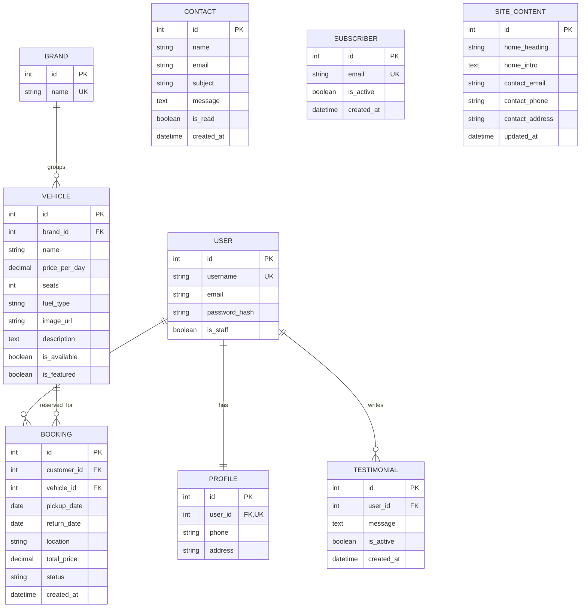

# Car Rentals E-R Diagram

This diagram reflects the current Django models and their deletion rules. The built-in Django user is shown as `User`.

## Keys And Relationship Rules

- `Profile.user_id` is unique: a user has one profile. Deleting the user deletes the profile.
- `Booking.customer_id` and `Booking.vehicle_id` are foreign keys. Deleting a user or vehicle deletes their bookings.
- `Testimonial.user_id` is a foreign key. Deleting a user deletes their testimonials.
- `Vehicle.brand_id` is protected while vehicles reference a brand. Remove or reassign its vehicles before deleting a brand.
- Brand names and subscriber email addresses are unique.
- Contact messages, subscribers, and editable site content are independent records and have no user foreign key.
- A booking's return date must be later than its pickup date. Pending and confirmed bookings cannot overlap for the same vehicle; cancelled bookings do not block dates.

The vehicle image is stored as a URL string (`Vehicle.image`), so this schema does not require file-storage infrastructure.

## Module Coordination

The booking module depends on `Vehicle.price_per_day` and `Vehicle.is_available`, and on the stable `Brand -> Vehicle` relation. Keep those names and meanings in sync when changing either module. The account and testimonial modules depend on Django's configured user model. Confirm relationship or deletion-policy changes with the booking/account owners before applying migrations.